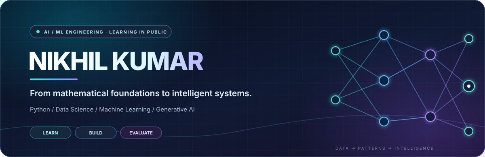

 

### BUILDING TOWARDS AI / MACHINE LEARNING ENGINEERING

*I’m developing a strong, math-first foundation in Python, data science and machine learning — with a long-term focus on deep learning, NLP, LLMs and intelligent AI systems.*

**Understand the fundamentals · Build real projects · Evaluate honestly**

---

## ✦ The Focus

<table>
  <tr>
    <td width="33%" valign="top">
      <h3>01 · Foundations</h3>
      
Python · NumPy · Pandas · SQL · EDA · Data visualization

      Turning raw data into reliable, useful datasets.
    </td>
    <td width="33%" valign="top">
      <h3>02 · Model Building</h3>
      
Linear algebra · Probability · Statistics · ML · Deep Learning · PyTorch

      Understanding the maths and mechanics behind models.
    </td>
    <td width="33%" valign="top">
      <h3>03 · Modern AI</h3>
      
NLP · Transformers · LLMs · GenAI · RAG · LangChain · Agents

      Working towards useful, evaluated AI applications.
    </td>
  </tr>
</table>

## ✦ Tools & Technologies

 

Tools shown above reflect my current foundations and learning direction. Advanced topics are roadmap goals, not claims of professional mastery.

---

## ✦ Selected Work

<table>
  <tr>
    <td width="50%" valign="top">
      <h3>🧠 Grude AI</h3>
      
<strong>Python · Local LLM · Voice AI</strong>

      
A voice-based personal AI assistant for Windows, described in the repository as using a local Llama 3 model, voice interaction, notes, weather and PC control.

      <a href="https://github.com/nikhilkumar210h-debug/grude-ai">VIEW REPOSITORY ↗</a>
    </td>
    <td width="50%" valign="top">
      <h3>📊 Smartprix Smartphone Data</h3>
      
<strong>Python · Pandas · NumPy · Data Cleaning</strong>

      
Collected and structured smartphone specifications, handled missing values and duplicates, and prepared an analysis-ready dataset. The project README reports 1,028 raw rows and 610 cleaned rows.

      <a href="https://github.com/nikhilkumar210h-debug/smartprix-smartphone-data-scraping">VIEW REPOSITORY ↗</a>
    </td>
  </tr>
  <tr>
    <td width="50%" valign="top">
      <h3>🏏 IPL Data Exploration</h3>
      
<strong>Python · Pandas · Matplotlib · EDA</strong>

      
Explores IPL match and delivery data from 2008–2017 through aggregations, team comparisons and statistical visualizations.

      <a href="https://github.com/nikhilkumar210h-debug/IPL-Data-Visualization-with-Matplotlib">VIEW REPOSITORY ↗</a>
    </td>
    <td width="50%" valign="top">
      <h3>🖼️ NumPy Image Processing</h3>
      
<strong>Python · NumPy · SciPy · Pillow</strong>

      
Pixel-level image operations including grayscale conversion, brightness, blur, sharpening and Sobel edge detection — useful computer-vision foundations.

      <a href="https://github.com/nikhilkumar210h-debug/image-processing-pipeline">VIEW REPOSITORY ↗</a>
    </td>
  </tr>
  <tr>
    <td width="50%" valign="top">
      <h3>📱 Samsung Data Cleaning</h3>
      
<strong>Python · Pandas · NumPy · Data Preparation</strong>

      
Collects Samsung smartphone information and transforms raw product details into a structured dataset for analysis.

      <a href="https://github.com/nikhilkumar210h-debug/Samsung-Smartphone-Data-Scraping-and-Cleaning">VIEW REPOSITORY ↗</a>
    </td>
    <td width="50%" valign="top">
      <h3>📚 AI/ML Study Track</h3>
      
<strong>Python · NumPy · Pandas · ML foundations</strong>

      
A forked learning resource I use to study structured AI/ML topics. Original course material belongs to its upstream maintainers.

      <a href="https://github.com/nikhilkumar210h-debug/Decode-AiML">VIEW STUDY RESOURCE ↗</a>
    </td>
  </tr>
</table>

---

## ✦ Learning Roadmap

| FOUNDATION | MACHINE LEARNING | INTELLIGENT SYSTEMS |
|:---|:---|:---|
| Mathematics for ML | Regression & Classification | NLP & Transformers |
| Python & OOP | Clustering & Dimensionality Reduction | LLM Architecture |
| NumPy & Pandas | Feature Engineering | Generative AI |
| SQL & Data Analysis | Model Validation & Evaluation | Embeddings & Vector Search |
| Probability & Statistics | Deep Learning & PyTorch | RAG & Retrieval Evaluation |
| Linear Algebra & Calculus | Neural Networks & CNNs | LangChain & LangGraph |
| Optimization | Experimentation & Error Analysis | Tool Use & Agentic AI |

Progress is tracked through notebooks, experiments and finished projects — not invented percentage bars.

## ✦ My Build Loop

**QUESTION** &nbsp; → &nbsp; **DATA** &nbsp; → &nbsp; **BASELINE** &nbsp; → &nbsp; **TRAIN** &nbsp; → &nbsp; **EVALUATE** &nbsp; → &nbsp; **IMPROVE**

I care about why a method works, where it fails, and whether the result is supported by evidence — not just whether the code runs.

---

## ✦ Contribution Trail

<picture>
  <source media="(prefers-color-scheme: dark)" srcset="https://raw.githubusercontent.com/nikhilkumar210h-debug/nikhilkumar210h-debug/output/github-contribution-grid-snake-dark.svg" />
  <source media="(prefers-color-scheme: light)" srcset="https://raw.githubusercontent.com/nikhilkumar210h-debug/nikhilkumar210h-debug/output/github-contribution-grid-snake.svg" />
  
</picture>

Fresh contribution animation · Generated automatically by GitHub Actions

---

### LEARN DEEPLY. BUILD THOUGHTFULLY. KEEP MOVING.

**Math → Data → Models → Generative AI → Intelligent Systems**

<a href="https://github.com/nikhilkumar210h-debug">GitHub</a> &nbsp; · &nbsp; <a href="https://www.kaggle.com/nikhilkumar210h">Kaggle</a>

