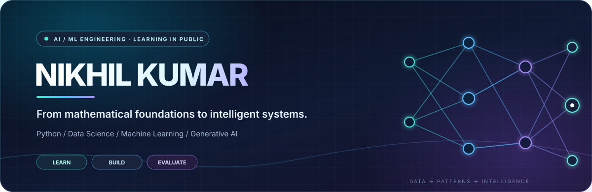

<!-- HERO BANNER -->

 

<!-- DYNAMIC SUBTITLE -->

 

<!-- PRIMARY ACTION & SOCIAL BAR -->

  
  &nbsp;
  
  &nbsp;
  

<!-- EXECUTIVE SUMMARY CARD -->
<table>
  <tr>
    <td align="center">
      

        <strong>Data Analyst &amp; Python Developer</strong> specializing in end-to-end ETL pipelines, SQL querying, and commercial EDA. 
        Implementing core ML algorithms from scratch—backed by <strong>Linear Algebra, Calculus &amp; Statistical Inference</strong>.
      

      

        
        &nbsp;
        
        &nbsp;
        
      

    </td>
  </tr>
</table>

<!-- EXECUTIVE SUMMARY CARD -->
<table>
  <tr>
    <td align="center">
      

        <strong>Data Analyst &amp; Python Developer</strong> specializing in end-to-end ETL pipelines, SQL querying, and commercial EDA. 
        Implementing core ML algorithms from scratch—backed by <strong>Linear Algebra, Calculus &amp; Statistical Inference</strong>.
      

      

        
        &nbsp;
        
        &nbsp;
        
      

<!-- EXECUTIVE SUMMARY CARD -->
<table>
  <tr>
    <td align="center">
      

        <strong>Data Analyst &amp; Python Developer</strong> specializing in end-to-end ETL pipelines, SQL querying, and commercial EDA. 
        Implementing core ML algorithms from scratch—backed by <strong>Linear Algebra, Calculus &amp; Statistical Inference</strong>.
      

      

        
        &nbsp;
        
        &nbsp;
        
      

<!-- SECTION 1: TECHNICAL ARSENAL -->
<h2><code>01 //</code> TECHNICAL STACK &amp; CAPABILITIES</h2>

<table>
  <tr>
    <td width="33.3%" valign="top">
      

        
      

      

        
        
        
        
        
      

      <ul>
        <li>Data Cleaning &amp; Deduplication</li>
        <li>Exploratory Data Analysis (EDA)</li>
        <li>KPI &amp; Profit Margin Engineering</li>
        <li>Relational Querying &amp; Joins</li>
      </ul>
    </td>
    <td width="33.3%" valign="top">
      

        
      

      

        
        
        
        
      

      <ul>
        <li>Executive Charts &amp; Distributions</li>
        <li>Automated Web Data Extraction</li>
        <li>Unstructured-to-CSV Pipelines</li>
        <li>Reproducible Notebooks</li>
      </ul>
    </td>
    <td width="33.3%" valign="top">
      

        
      

      

        
        
        
        
      

      <ul>
        <li>Matrix Decomposition (EVD / SVD)</li>
        <li>Probability &amp; Hypothesis Testing</li>
        <li>Feature Engineering &amp; PCA</li>
        <li>Model Evaluation &amp; Baselines</li>
      </ul>
    </td>
  </tr>
</table>

 

<!-- SECTION 2: FEATURED PROJECTS -->
<h2><code>02 //</code> FEATURED DATA &amp; ML ENGINEERING PROJECTS</h2>

<table>
  <tr>
    <td width="50%" valign="top">
      <h3>🧬 PCA Image Compression Engine (EVD vs. SVD)</h3>
      

        
        
        
        
      

      
Built a reusable <code>CustomPCA</code> engine from scratch in pure NumPy on <strong>Fashion-MNIST (60k × 784)</strong>. Achieved <strong>89% dimensionality reduction</strong> (84 components for 90% variance) and proved EVD runs <strong>~6.5× faster</strong> than SVD when <em>n ≫ d</em>.

      
    </td>
    <td width="50%" valign="top">
      <h3>📊 UrbanCart D2C Sales &amp; Profit Analysis</h3>
      

        
        
        
        
      

      
End-to-end commercial analysis of <strong>2,500+ D2C orders</strong> across 5 categories and 8 cities. Cleaned corrupted entries, engineered net profit/loss margins, and uncovered high-return revenue leaks.

      
    </td>
  </tr>
  <tr>
    <td width="50%" valign="top">
      <h3>🖼️ NumPy Computer Vision Pipeline</h3>
      

        
        
        
        
      

      
Implemented core image processing kernels from scratch using pure matrix math—featuring grayscale transforms, brightness scaling, convolution blur, sharpening, and Sobel edge detection.

      
    </td>
    <td width="50%" valign="top">
      <h3>📱 Smartphone Catalog ETL &amp; Scraping Pipelines</h3>
      

        
        
        
        
      

      
Parsed and standardized messy Smartprix &amp; Samsung smartphone hardware listings. Resolved missing specs, normalized units, and distilled <strong>1,028 raw records into 610 analysis-ready rows</strong>.

      
    </td>
  </tr>
</table>

 

<!-- SECTION 3: METHODOLOGY & ROADMAP -->
<h2><code>03 //</code> ANALYTICAL WORKFLOW &amp; ENGINEERING ROADMAP</h2>

 

  

<table>
  <tr>
    <td width="33.3%" valign="top">
      
      

        ✓ Python, NumPy, Pandas, Matplotlib &amp; Seaborn 
        ✓ SQL (DuckDB, SQLite, MySQL &amp; XAMPP) 
        ✓ Linear Algebra (EVD, SVD &amp; Custom PCA) 
        ✓ Differential Calculus &amp; Optimization 
        ✓ Probability &amp; Inferential Statistics (Hypothesis Testing)
      

    </td>
    <td width="33.3%" valign="top">
      
      

        ◈ Supervised ML (Regression &amp; Classification) 
        ◈ Tree Ensembles (Random Forest, XGBoost, LightGBM) 
        ◈ Support Vector Machines, KNN &amp; Naive Bayes 
        ◈ Unsupervised Learning (K-Means Clustering) 
        ◈ Feature Engineering &amp; Cross-Validation (Scikit-Learn)
      

    </td>
    <td width="33.3%" valign="top">
      
      

        ○ Deep Learning &amp; PyTorch (CNNs, RNNs) 
        ○ NLP &amp; Transformers (Hugging Face) 
        ○ LLMs, Fine-Tuning (LoRA) &amp; RAG (ChromaDB) 
        ○ Agentic AI (LangChain, CrewAI, AutoGen, MCP) 
        ○ MLOps (FastAPI, Docker, MLflow), Cloud &amp; System Design
      

    </td>
  </tr>
</table>

 

<!-- SECTION 4: CONTRIBUTION GRAPH -->
<h2><code>04 //</code> CONSISTENCY &amp; CONTRIBUTION TRAIL</h2>

 

<picture>
  <source media="(prefers-color-scheme: dark)" srcset="https://raw.githubusercontent.com/nikhilkumar210h-debug/nikhilkumar210h-debug/output/github-contribution-grid-snake-dark.svg" />
  <source media="(prefers-color-scheme: light)" srcset="https://raw.githubusercontent.com/nikhilkumar210h-debug/nikhilkumar210h-debug/output/github-contribution-grid-snake.svg" />
  
</picture>

  

**Understand the fundamentals · Build real projects · Evaluate honestly**

  <a href="https://github.com/nikhilkumar210h-debug">GitHub</a> &nbsp;•&nbsp;
  <a href="https://www.kaggle.com/nikhilkumar210h">Kaggle</a> &nbsp;•&nbsp;
  <a href="mailto:nikhilkumar45374@gmail.com">nikhilkumar45374@gmail.com</a>

